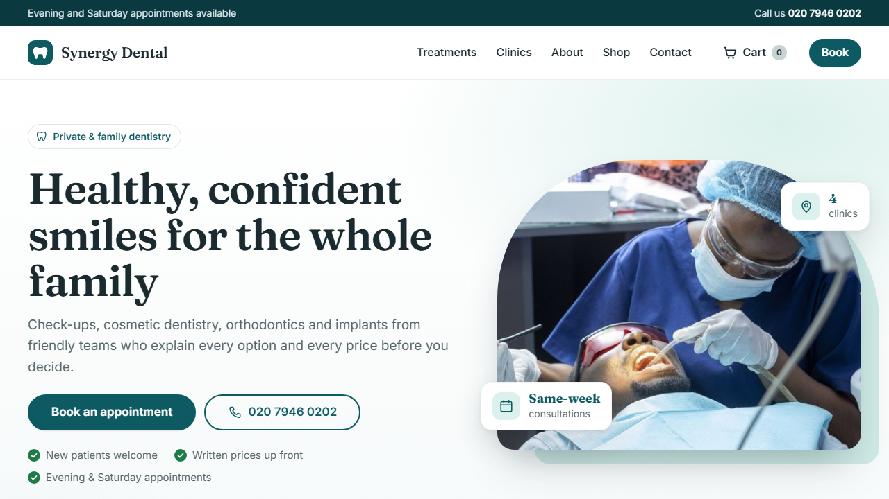
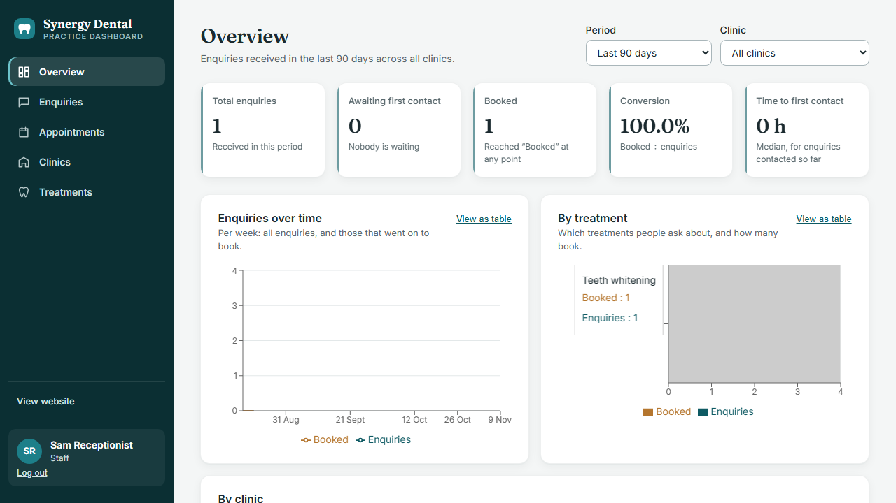
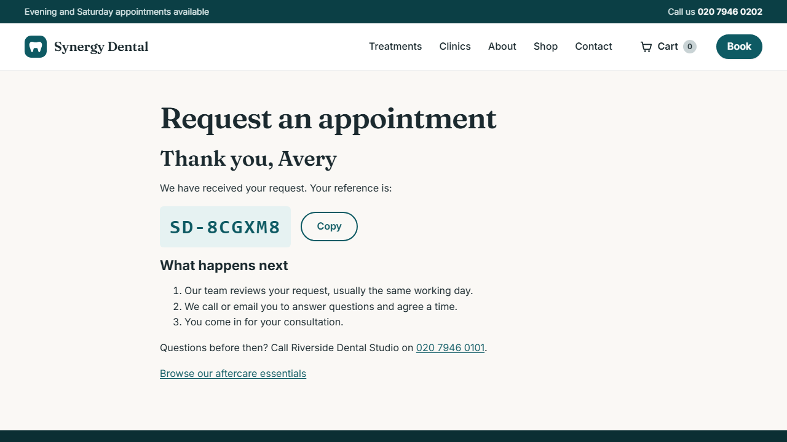
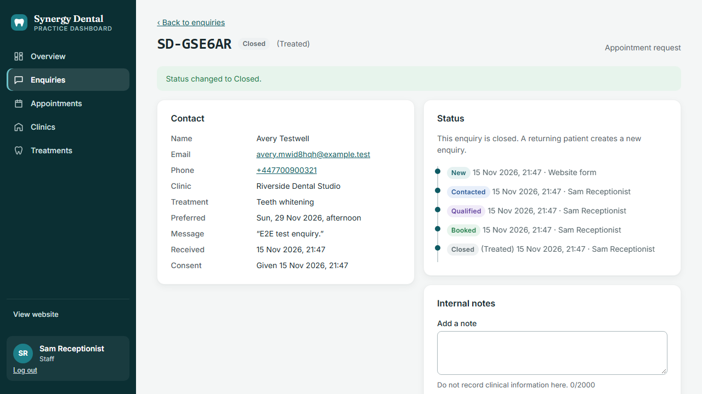

# Synergy Dental – Full-Stack Digital Platform (Technical Demonstration)

> **Disclaimer:** This is an independent technical demonstration built by a job applicant.
> It is **not** affiliated with, commissioned by, or endorsed by Synergy Dental Group or any
> related company. All clinics, people, patients, products and data are fictional.
> No real payments are processed and no real patient health information is collected.

## Status

**Phases 1–6 complete; Phase 8 deployment prepared.** The business API, staff dashboard,
WordPress site, WooCommerce shop and their integration are built and tested
(66 API tests, 14 dashboard tests, 6 end-to-end journeys with accessibility checks).
See [`docs/PROJECT_CHECKLIST.md`](docs/PROJECT_CHECKLIST.md) for live progress and
[`docs/ROADMAP.md`](docs/ROADMAP.md) for the development plan.

## What this project demonstrates

| Area | Technology | Purpose in this project |
|---|---|---|
| Public website / CMS | WordPress (PHP, custom theme + plugin) | Patient-facing marketing site, treatment & clinic content |
| E-commerce | WooCommerce | Demo shop for oral-care products with simulated checkout |
| Business API | Python, FastAPI, Pydantic | Enquiries, auth, RBAC, analytics |
| Business database | PostgreSQL, SQLAlchemy, Alembic | Enquiries, users, clinics, treatments, status history |
| Staff dashboard | React (Vite), JavaScript ES6+ | Secure internal management interface |
| Testing | Pytest, Vitest + React Testing Library, Playwright, Postman | Unit, integration and end-to-end testing |
| Infrastructure | Docker Compose; single cloud VM (AWS or Azure) | Reproducible local environment and deployment |

## Running locally

Requires Docker Desktop (WSL 2 backend on Windows).

```sh
cp .env.example .env      # then replace every CHANGE_ME value
docker compose up --build
```

| URL | Service |
|---|---|
| http://localhost:8080/ | WordPress (installer until Phase 5 provisioning) |
| http://localhost:8080/dashboard/ | React staff dashboard |
| http://localhost:8080/api/v1/health | FastAPI liveness (`/health/ready` also checks PostgreSQL) |
| http://localhost:8080/api/v1/docs | OpenAPI docs |

First start takes a few minutes: the `migrate` service seeds 5,000 fictional enquiries and the
`wpcli` service installs WordPress + WooCommerce and the demo content.

Demo logins (local): `admin@example.test` / `SEED_ADMIN_PASSWORD`, `staff@example.test` /
`SEED_STAFF_PASSWORD` (values from your `.env`). WordPress admin: `/wp-admin/` with `WP_ADMIN_USER`.

Tests:

```sh
docker compose exec api pytest          # API, against real PostgreSQL
cd dashboard && npm test                # React components
cd e2e && npx playwright test           # end-to-end journeys (needs the stack running)
```

Deployment: see [doc 10](docs/10-deployment.md).

## Screenshots

| Website | Staff dashboard |
|---|---|
|  |  |
|  |  |

## Documentation

| # | Document | Status |
|---|---|---|
| 01 | [Project Proposal](docs/01-project-proposal.md) | Complete (Phase 1) |
| 02 | [Requirements Specification](docs/02-requirements-specification.md) | Baselined |
| 03 | [System Architecture](docs/03-system-architecture.md) | Approved |
| 04 | [Database Design](docs/04-database-design.md) | Draft for review |
| 05 | [API Documentation](docs/05-api-documentation.md) | Contract draft |
| — | [UI Design (tokens + wireframes)](docs/design/ui-design.md) | Draft for review |
| 10 | [Deployment](docs/10-deployment.md) | Implemented |
| 06–09, 11 | Implementation, Testing, Security, Performance, Final Report | Not started |
