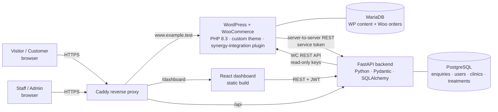
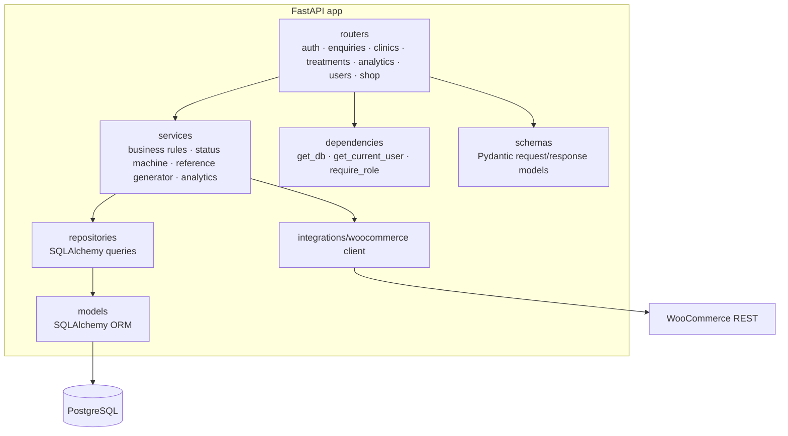
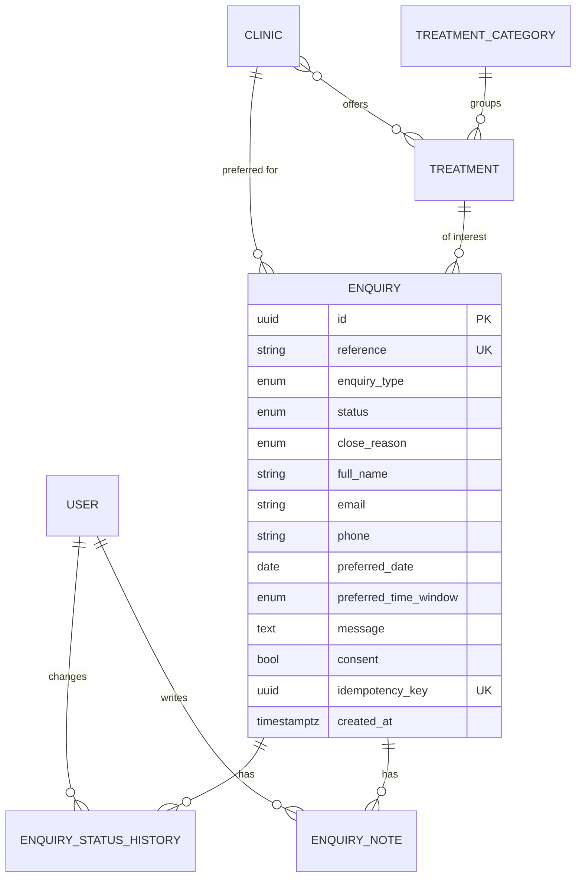
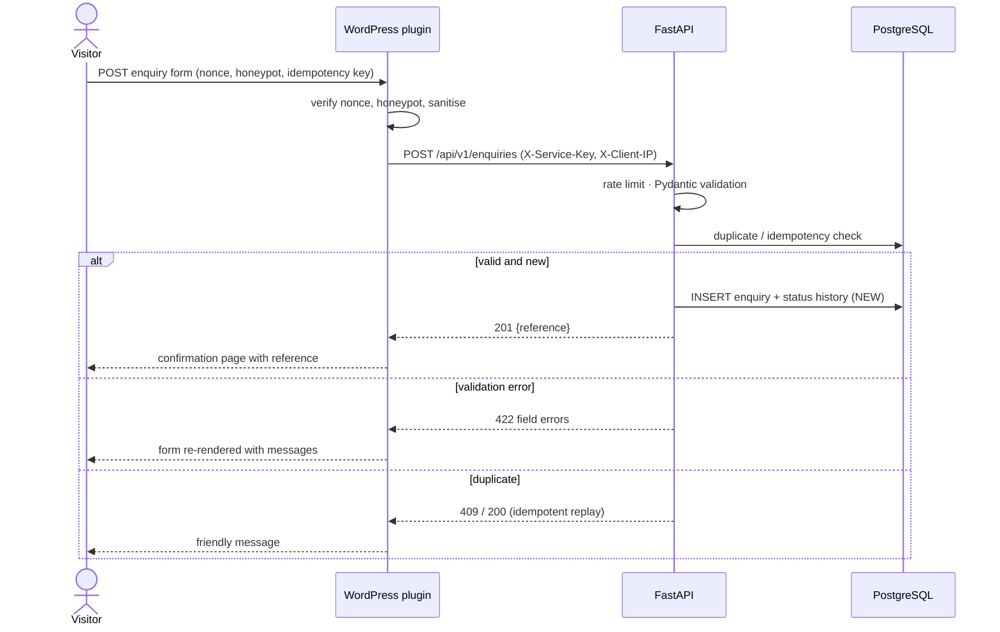
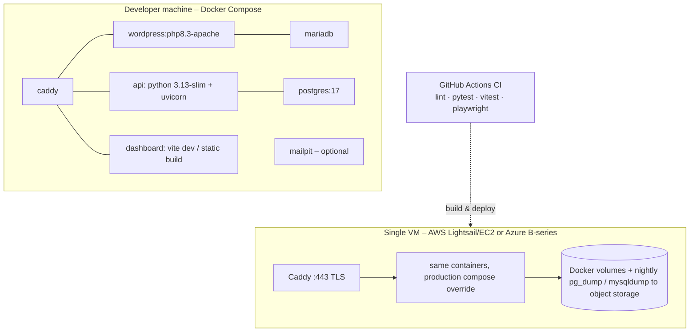

# 03 – System Architecture

**Status:** Approved by project owner 2026-11-13 (end of Phase 1). Diagrams use
Mermaid, which GitHub renders natively. · **Last updated:** 2026-11-13

## 1. Architecture summary

This is a **modular monolith plus a CMS**, not microservices. It has two applications, each with its
own database, connected by REST:

1. **WordPress + WooCommerce** (PHP, MariaDB): the public website, content management and shop.
2. **FastAPI** (Python, PostgreSQL): the business API for enquiries, users, analytics and canonical
   clinic/treatment data.

A **React** single-page application is the staff dashboard. It talks only to FastAPI. A reverse proxy
(Caddy) puts everything behind one domain and handles TLS in production.

## 2. High-level architecture



## 3. Component responsibilities

| Component | Responsibility | Why this technology | Alternatives considered |
|---|---|---|---|
| WordPress (custom theme) | Public pages, SEO, editor-friendly content | Industry standard for marketing sites; non-developers can edit content; matches the job's WordPress requirement | React/Next.js public site: better DX, but duplicates CMS functionality and adds no editing workflow for staff |
| `synergy-integration` plugin (PHP) | CPTs, custom fields, enquiry form shortcode/block, FastAPI client, settings page, WooCommerce customisations | Keeps business logic out of the theme (themes can be swapped; plugins persist) | ACF Pro for fields: faster, but a paid dependency that hides the underlying WP APIs I want to demonstrate |
| WooCommerce | Catalogue, cart, checkout, orders | Requirement; mature; extensible with hooks | Shopify / Stripe Checkout: not WordPress-integrated |
| FastAPI | Business REST API, validation, auth, RBAC, analytics | Async, type-hinted, auto-generated OpenAPI docs, Pydantic validation | Django REST Framework: heavier, has its own ORM. Flask: less built-in validation and docs |
| PostgreSQL | Business data of record | Strong constraints, enums, partial indexes, good aggregate queries for analytics | MySQL: possible, but the brief requires PostgreSQL |
| SQLAlchemy 2.x + Alembic | ORM and versioned migrations | Parameterised queries (SQL-injection safe), typed models, reviewable migrations | SQLModel: thinner, but less mature for complex queries |
| React (Vite) dashboard | Interactive staff UI | Component reuse, rich state, charts | Server-rendered admin (Jinja/WP admin): less interactive and doesn't demonstrate React |
| MariaDB | WordPress database | **WordPress does not support PostgreSQL** | — |
| Caddy | Reverse proxy, automatic HTTPS | One small config file, automatic Let's Encrypt | Nginx + certbot: more configuration |

## 4. Key architecture decisions (ADR-lite)

**ADR-01 – Public site in WordPress, dashboard in React.** Each technology does what it is best at,
and both are visibly real. *Trade-off:* two front-end technologies to maintain. **Approved 2026-11-13.**

**ADR-02 – Enquiries go server-to-server from WordPress to FastAPI.** The form posts to WordPress.
The plugin validates the nonce and honeypot, then calls `POST /api/v1/enquiries` with a service API
key over the internal Docker network. Benefits: the API key never reaches the browser, the public API
needs no CORS, the form works without JavaScript, and FastAPI still validates everything again with
Pydantic. Rate limiting uses the original client IP, forwarded in a header that only the trusted
plugin may set.

**ADR-03 – Two databases.** PostgreSQL holds the business data and MariaDB holds WordPress data. This
is forced by WordPress, and it also keeps clear ownership boundaries.

**ADR-04 – PostgreSQL is the canonical source for clinics and treatments.** WordPress CPTs hold
marketing content and link to the API records by `slug`. The plugin caches the API's list in a WP
transient (10 min) to fill the form dropdowns. A WP-CLI command `wp synergy sync-check` reports any
slug that exists on one side but not the other.

**ADR-05 – Authentication.** OAuth2 password flow → short-lived JWT access token (15 min) plus a
rotating refresh token in an `HttpOnly; Secure; SameSite=Strict` cookie. Passwords are hashed with
Argon2id (`pwdlib`; `passlib` is unmaintained). The dashboard and API are served from the same origin,
which keeps CORS to an explicit allow-list. *Simpler fallback, if time-boxed:* access token only, held
in memory.

**ADR-06 – Shop data reaches the dashboard by pull.** FastAPI calls the WooCommerce REST API with
read-only consumer keys and caches the result briefly. Webhooks (push) are documented as a future
improvement.

**ADR-07 – Status workflow enforced in the service layer.** A transition table defines the allowed
moves. Every change writes an `enquiry_status_history` row (who, from, to, when), which also supplies
the conversion and time-to-contact metrics.

## 5. Component view (backend)



Planned repository layout:

```
/backend      FastAPI app (app/api, app/services, app/repositories, app/models, app/schemas, app/core), alembic/, tests/
/dashboard    React + Vite (src/components, src/pages, src/api, src/hooks, src/utils), tests
/wordpress    wp-content/themes/synergy-theme, wp-content/plugins/synergy-integration, setup scripts (WP-CLI)
/e2e          Playwright tests
/infra        Caddyfile, deployment scripts
/postman      Exported API collection + environment
/docs         Documentation 01–11, diagrams, screenshots
docker-compose.yml · .env.example · .github/workflows/ci.yml
```

## 6. Initial domain model (refined into the full ERD in doc 04)



Indexes planned: `(status, created_at)`, `(clinic_id)`, `(treatment_id)`, `lower(email)`, plus a
partial index that supports the duplicate check on open enquiries.

## 7. Key data flows

### 7.1 Enquiry submission



### 7.2 Staff status update

Dashboard `PATCH /api/v1/enquiries/{id}/status` (JWT) → `require_role(STAFF)` → the status machine
validates the transition → the update and the history row are written in one transaction → the
analytics endpoints reflect the change on the next request.

## 8. Deployment architecture



I chose one VM running Docker Compose over managed services (RDS, ECS, App Service) because it is
cheap, mirrors the local environment exactly, and is simple to explain. Managed services are discussed
in doc 10 as the production path.

## 9. Decisions recorded at the end of Phase 1 (2026-11-13)

| Item | Decision |
|---|---|
| ADR-01 (WordPress public site, React dashboard only) | Approved as proposed |
| Repository location | `C:\dev\synergy-dental-platform` (outside OneDrive, no spaces in path) |
| Cloud provider | Deferred to Phase 8; deployment is optional. The local Docker Compose stack is the primary deliverable |
| Docker Desktop + WSL 2 | Owner installs; Phase 2 container work waits for `docker run hello-world` to succeed |
| Job advert text | Still outstanding (gap G8); technology emphasis follows the brief until it is supplied |
