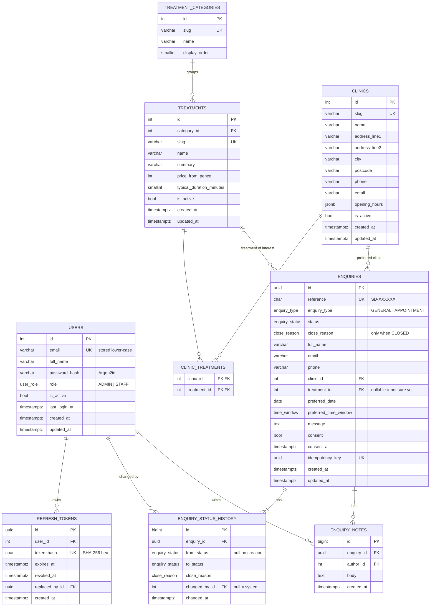

# 04 – Database Design

**Status:** Draft for review (Phase 2). This is the contract for the SQLAlchemy models and the
first Alembic migration in Phase 3. Anything that changes during implementation is recorded in
§9 (change log) rather than silently edited. · **Last updated:** 2026-11-13

Scope: this document covers the **PostgreSQL** business database owned by FastAPI. The WordPress
database (MariaDB) uses the standard WordPress/WooCommerce schema and is not redesigned. Only the
custom post meta our plugin adds is listed in §8.

## 1. Design principles

| Principle | How it is applied | Why |
|---|---|---|
| The database enforces its own rules | `NOT NULL`, `CHECK`, `UNIQUE`, foreign keys and PostgreSQL enums, not only Pydantic | A bug in the API, or a manual SQL fix, cannot store an impossible state such as `CLOSED` with no reason |
| Non-guessable public identifiers | `enquiries.id` is a UUID; staff see a short random `reference` | Sequential IDs in URLs leak volume and invite enumeration |
| Small integer keys for reference data | Clinics, treatments, categories and users use `integer GENERATED ALWAYS AS IDENTITY` | Compact, readable in seed data and URLs, and not sensitive |
| Time is always UTC | Every timestamp is `timestamptz`, written by the database (`DEFAULT now()`) | Avoids time-zone bugs in analytics; the UI converts to Europe/London |
| Money is an integer | Prices are stored in pence (`integer`) | No floating-point rounding |
| Soft deletion for reference data | Clinics, treatments and users have `is_active` | Old enquiries keep valid foreign keys and analytics stay correct |
| History is append-only | Status changes are written to `enquiry_status_history` and never updated | Audit trail, and the source of conversion and time-to-contact metrics |
| Minimal personal data | Name, email, phone, optional message only. No date of birth, no address, no clinical notes. IP addresses are **not** stored | Privacy by design (NFR-04) |

## 2. Entity relationship diagram



## 3. Enumerated types

PostgreSQL native enums are used because the value sets are small, stable and validated in three
places (DB, Pydantic, React) from one definition. Adding a value later needs a migration
(`ALTER TYPE … ADD VALUE`), which is acceptable for these sets.

| Enum | Values | Notes |
|---|---|---|
| `user_role` | `ADMIN`, `STAFF` | Permission matrix in doc 02 §5 |
| `enquiry_type` | `GENERAL`, `APPOINTMENT` | Gap G1: one table, two types |
| `enquiry_status` | `NEW`, `CONTACTED`, `QUALIFIED`, `BOOKED`, `CLOSED` | Transitions enforced in the service layer (doc 05 §6) |
| `close_reason` | `TREATED`, `NOT_INTERESTED`, `UNREACHABLE`, `DUPLICATE`, `OTHER` | Gap G2: makes "closed" meaningful for conversion |
| `time_window` | `MORNING`, `AFTERNOON`, `EVENING` | Preferred appointment time window |

## 4. Table descriptions and constraints

### 4.1 `users`
Staff and administrators of the dashboard. WordPress editors are **not** in this table; they are
managed by WordPress.

| Column | Type | Constraints |
|---|---|---|
| `id` | integer identity | PK |
| `email` | varchar(254) | NOT NULL, UNIQUE, `CHECK (email = lower(email))` |
| `full_name` | varchar(120) | NOT NULL |
| `password_hash` | varchar(255) | NOT NULL (Argon2id encoded string, includes salt and parameters) |
| `role` | `user_role` | NOT NULL, default `STAFF` |
| `is_active` | boolean | NOT NULL, default true. Deactivated users cannot log in |
| `last_login_at` | timestamptz | NULL |
| `created_at`, `updated_at` | timestamptz | NOT NULL, default `now()` |

### 4.2 `refresh_tokens`
Supports ADR-05 (rotating refresh tokens). Only a **SHA-256 hash** of the token is stored, so a
database leak does not expose usable tokens. When a token is used it is revoked and
`replaced_by_id` points to its successor. If a revoked token is presented again, that indicates
theft, and every token in the chain for that user is revoked.
*MVP fallback (ROADMAP): if time runs short this table is dropped and access tokens only are used.*

| Column | Type | Constraints |
|---|---|---|
| `id` | uuid | PK, default `gen_random_uuid()` |
| `user_id` | integer | NOT NULL, FK → `users.id` ON DELETE CASCADE |
| `token_hash` | char(64) | NOT NULL, UNIQUE |
| `expires_at` | timestamptz | NOT NULL |
| `revoked_at` | timestamptz | NULL |
| `replaced_by_id` | uuid | NULL, FK → `refresh_tokens.id` ON DELETE SET NULL |
| `created_at` | timestamptz | NOT NULL, default `now()` |

### 4.3 `clinics`
Canonical clinic records (ADR-04). WordPress `clinic` posts link to these by `slug`.

| Column | Type | Constraints |
|---|---|---|
| `id` | integer identity | PK |
| `slug` | varchar(80) | NOT NULL, UNIQUE, `CHECK (slug ~ '^[a-z0-9]+(-[a-z0-9]+)*$')` |
| `name` | varchar(120) | NOT NULL |
| `address_line1` | varchar(120) | NOT NULL |
| `address_line2` | varchar(120) | NULL |
| `city` | varchar(80) | NOT NULL |
| `postcode` | varchar(10) | NOT NULL |
| `phone` | varchar(32) | NOT NULL |
| `email` | varchar(254) | NULL |
| `opening_hours` | jsonb | NOT NULL, default `'{}'`. Shape validated by Pydantic: `{"mon": [["08:30","17:30"]], …}` |
| `is_active` | boolean | NOT NULL, default true |
| `created_at`, `updated_at` | timestamptz | NOT NULL, default `now()` |

`jsonb` is used for opening hours because they are always read and written as a whole, never
queried by day. A separate `opening_hours` table would add joins and give nothing back here.

### 4.4 `treatment_categories`
| Column | Type | Constraints |
|---|---|---|
| `id` | integer identity | PK |
| `slug` | varchar(80) | NOT NULL, UNIQUE, slug CHECK as above |
| `name` | varchar(80) | NOT NULL, UNIQUE |
| `display_order` | smallint | NOT NULL, default 0 |

### 4.5 `treatments`
| Column | Type | Constraints |
|---|---|---|
| `id` | integer identity | PK |
| `category_id` | integer | NOT NULL, FK → `treatment_categories.id` ON DELETE RESTRICT |
| `slug` | varchar(80) | NOT NULL, UNIQUE, slug CHECK |
| `name` | varchar(120) | NOT NULL |
| `summary` | varchar(300) | NULL (short text for the dashboard; long marketing copy lives in WordPress) |
| `price_from_pence` | integer | NULL, `CHECK (price_from_pence >= 0)` |
| `typical_duration_minutes` | smallint | NULL, `CHECK (typical_duration_minutes > 0)` |
| `is_active` | boolean | NOT NULL, default true |
| `created_at`, `updated_at` | timestamptz | NOT NULL, default `now()` |

`ON DELETE RESTRICT` on the category means a category cannot be deleted while treatments use it.
The API turns the resulting integrity error into a `409 CATEGORY_IN_USE`.

### 4.6 `clinic_treatments`
Many-to-many: which treatments each clinic offers. Composite PK `(clinic_id, treatment_id)`. Both
FKs `ON DELETE CASCADE`. In practice rows are only removed through the API, because clinics and
treatments are deactivated rather than deleted.

### 4.7 `enquiries`
The core business table. Appointment requests are enquiries with `enquiry_type = 'APPOINTMENT'`.

| Column | Type | Constraints |
|---|---|---|
| `id` | uuid | PK, default `gen_random_uuid()` |
| `reference` | char(9) | NOT NULL, UNIQUE, `CHECK (reference ~ '^SD-[2-9A-HJKMNP-Z]{6}$')` |
| `enquiry_type` | `enquiry_type` | NOT NULL |
| `status` | `enquiry_status` | NOT NULL, default `NEW` |
| `close_reason` | `close_reason` | NULL |
| `full_name` | varchar(120) | NOT NULL, `CHECK (length(trim(full_name)) >= 2)` |
| `email` | varchar(254) | NOT NULL (stored lower-case) |
| `phone` | varchar(32) | NOT NULL (normalised to E.164-style `+44…` by the API) |
| `clinic_id` | integer | NOT NULL, FK → `clinics.id` ON DELETE RESTRICT |
| `treatment_id` | integer | NULL ("not sure yet"), FK → `treatments.id` ON DELETE RESTRICT |
| `preferred_date` | date | NULL |
| `preferred_time_window` | `time_window` | NULL |
| `message` | text | NULL, `CHECK (length(message) <= 2000)` |
| `consent` | boolean | NOT NULL, `CHECK (consent)`. An enquiry cannot exist without consent |
| `consent_at` | timestamptz | NOT NULL, default `now()` |
| `idempotency_key` | uuid | NULL, UNIQUE |
| `created_at`, `updated_at` | timestamptz | NOT NULL, default `now()` |

Table-level CHECK constraints:

```sql
-- A closed enquiry must say why; an open one must not have a reason.
CONSTRAINT ck_enquiries_close_reason
  CHECK ((status = 'CLOSED') = (close_reason IS NOT NULL)),
-- Appointment requests must have a preferred date.
CONSTRAINT ck_enquiries_appointment_date
  CHECK (enquiry_type <> 'APPOINTMENT' OR preferred_date IS NOT NULL)
```

"The preferred date must not be in the past" is validated in Pydantic, not in a CHECK. A CHECK
that uses `now()` would make old rows invalid as time passes and break restores.

**Reference format.** `SD-` followed by 6 characters from a 31-character alphabet that removes
look-alikes (`0 O 1 I L`): `23456789ABCDEFGHJKMNPQRSTUVWXYZ`. This gives 31⁶ ≈ 887 million
combinations. References are generated with Python's `secrets` module. If the insert hits a
unique violation on `reference`, generation is retried (up to 5 times) inside a savepoint.
References are random rather than sequential, so they do not reveal enquiry volume.

### 4.8 `enquiry_status_history`
| Column | Type | Constraints |
|---|---|---|
| `id` | bigint identity | PK |
| `enquiry_id` | uuid | NOT NULL, FK → `enquiries.id` ON DELETE CASCADE |
| `from_status` | `enquiry_status` | NULL only for the creation row |
| `to_status` | `enquiry_status` | NOT NULL |
| `close_reason` | `close_reason` | NULL, `CHECK ((to_status = 'CLOSED') = (close_reason IS NOT NULL))` |
| `changed_by_id` | integer | NULL (system/public submission), FK → `users.id` ON DELETE RESTRICT |
| `changed_at` | timestamptz | NOT NULL, default `now()` |

Every enquiry gets a first row `(NULL → NEW)` in the same transaction that creates it, which is why
the ERD shows the relationship as "one or more".

### 4.9 `enquiry_notes`
| Column | Type | Constraints |
|---|---|---|
| `id` | bigint identity | PK |
| `enquiry_id` | uuid | NOT NULL, FK → `enquiries.id` ON DELETE CASCADE |
| `author_id` | integer | NOT NULL, FK → `users.id` ON DELETE RESTRICT |
| `body` | text | NOT NULL, `CHECK (length(trim(body)) BETWEEN 1 AND 2000)` |
| `created_at` | timestamptz | NOT NULL, default `now()` |

Notes are internal and are never returned to the public API. They must not contain clinical
information; the dashboard shows a reminder of that next to the note field.

## 5. Relationship and delete behaviour summary

| Parent → child | On delete | Reason |
|---|---|---|
| `enquiries` → history, notes | CASCADE | An admin hard-delete (e.g. a data-erasure request) removes everything about that person |
| `clinics` / `treatments` → `enquiries` | RESTRICT | Reference data is deactivated, never deleted, so analytics stay intact |
| `treatment_categories` → `treatments` | RESTRICT | Returns `409 CATEGORY_IN_USE` |
| `users` → history, notes | RESTRICT | Users are deactivated, not deleted, so the audit trail keeps its author |
| `users` → `refresh_tokens` | CASCADE | Tokens have no meaning without the user |

## 6. Business rules that touch the database

### 6.1 Duplicate prevention (FR-ENQ-06)
1. **Idempotency (double-click / retry).** The WordPress form embeds a UUID generated when the form
   is rendered and sends it as the `Idempotency-Key` header. If a row already has that key, the API
   returns the **original** enquiry (`200`) instead of creating another. The `UNIQUE` constraint
   makes this safe even when two identical requests arrive at the same moment: one insert wins and
   the other catches the violation and returns the winner.
2. **Business duplicate (same person, same request).** If an *open* enquiry (status not `CLOSED`)
   exists with the same `lower(email)`, `clinic_id` and `treatment_id` created in the last 24 hours,
   the API returns `409 DUPLICATE_ENQUIRY` with the existing reference.
   *Race condition:* two different submissions in the same millisecond could both pass the check.
   To prevent that, the check and the insert run in one transaction after
   `pg_advisory_xact_lock(hashtext(lower(email)))`, which serialises submissions per email address
   only. A unique index cannot express "within 24 hours", which is why a lock is used here.

### 6.2 Status changes (ADR-07)
`UPDATE enquiries SET status …` and `INSERT INTO enquiry_status_history …` always happen in the same
transaction. The row is read with `SELECT … FOR UPDATE` first, so two staff members changing the
same enquiry at once cannot both act on a stale status. The second one gets `409 INVALID_TRANSITION`.

### 6.3 Analytics definitions (FR-DASH-10)
All analytics are computed from these tables on request. Nothing is hard-coded and there are no
summary tables yet.

| Metric | Definition (for enquiries **created** in the selected period) |
|---|---|
| Total enquiries | `count(*)` |
| New | `count(*) FILTER (WHERE status = 'NEW')` (current status) |
| Booked | Enquiries with **any** history row `to_status = 'BOOKED'`. This counts enquiries that were booked and later closed as `TREATED` |
| Conversion rate | Booked ÷ Total, returned as a fraction (0–1); `null` when Total = 0 |
| By treatment / by clinic | The same metrics grouped by `treatment_id` / `clinic_id`; a `NULL` treatment is reported as "Not sure yet" |
| Median time to first contact | Median of (first `CONTACTED` `changed_at` − `created_at`), using `percentile_cont(0.5)` (Should) |

Booked uses `EXISTS (SELECT 1 FROM enquiry_status_history h WHERE h.enquiry_id = e.id AND
h.to_status = 'BOOKED')`. Current status alone would be wrong, because a booked enquiry that was
then closed would disappear from the booked count.

## 7. Indexing decisions

Indexes are chosen from the queries the dashboard actually runs. In Phase 7 each one will be
checked with `EXPLAIN ANALYZE` against about 5,000 seeded enquiries, and the results recorded in
doc 09. Any index that the planner never uses will be removed.

| Index | Serves | Notes |
|---|---|---|
| `ix_enquiries_created_at` on `(created_at DESC)` | Default list (newest first), date-range filters, analytics period | |
| `ix_enquiries_status_created_at` on `(status, created_at DESC)` | "New enquiries" filter, the most common staff view (US-04) | |
| `ix_enquiries_clinic_id`, `ix_enquiries_treatment_id` | FK joins, clinic/treatment filters, group-by analytics | PostgreSQL does **not** index FKs automatically |
| `ix_enquiries_email_lower` on `(lower(email))` | Exact email search; duplicate check | |
| `ix_enquiries_open_dupe` on `(lower(email), clinic_id, treatment_id, created_at)` `WHERE status <> 'CLOSED'` | Duplicate check (§6.1) | Partial index: only open enquiries, so it stays small |
| `ix_enquiries_search_trgm` GIN on `(full_name gin_trgm_ops)` and `(email gin_trgm_ops)` | Free-text search `ILIKE '%term%'` (FR-DASH-04) | Needs the `pg_trgm` extension. A normal B-tree cannot serve a leading wildcard |
| `ix_status_history_enquiry` on `(enquiry_id, changed_at)` | Detail-page timeline | |
| `ix_status_history_to_status` on `(to_status, enquiry_id)` | Booked/conversion `EXISTS` sub-queries | |
| `ix_enquiry_notes_enquiry` on `(enquiry_id, created_at)` | Detail-page notes | |
| `UNIQUE` on `reference`, `idempotency_key`, slugs, `users.email`, `token_hash` | Lookups plus integrity | Unique constraints create their own index |

## 8. WordPress side (for reference only)

Custom data the `synergy-integration` plugin adds to the **MariaDB** WordPress database:

| Object | Key | Type | Purpose |
|---|---|---|---|
| CPT `treatment` meta | `sd_api_slug` | string | Links to `treatments.slug` in PostgreSQL |
| | `sd_summary`, `sd_duration`, `sd_price_from` | string / int / int (pence) | Display fields (FR-PUB-04) |
| | `sd_faqs` | JSON string (array of `{q, a}`) | FAQ block + `FAQPage` structured data |
| CPT `clinic` meta | `sd_api_slug` | string | Links to `clinics.slug` |
| | `sd_map_url` | string (URL) | "Get directions" link |
| Taxonomy | `treatment_category` | terms | Mirrors category slugs |
| Product meta (Woo) | `_sd_recommended_after` | string (treatment slug) | FR-SHOP-06 custom field |
| Option | `synergy_integration_settings` | array | API base URL; the service key comes **only** from the environment, never the options table |
| Transient | `sd_reference_data` | array | 10-minute cache of clinics/treatments from the API |

## 9. Migration strategy

- **Tool:** Alembic, with `env.py` importing the SQLAlchemy `Base.metadata` so autogenerate can see
  the models.
- **Autogenerate, then review by hand.** Autogenerate does not handle enum creation, `CHECK`
  constraints, partial/functional/GIN indexes or extensions reliably, so every generated script is
  edited and reviewed before it is committed.
- **Naming convention.** A SQLAlchemy `naming_convention` (`pk_`, `fk_`, `uq_`, `ck_`, `ix_`) makes
  constraint names predictable, so later migrations can drop them by name.
- **Planned revisions:**
  1. `0001_extensions_and_enums`: `pgcrypto` (for `gen_random_uuid()`), `pg_trgm`, all enums.
  2. `0002_reference_and_users`: users, refresh_tokens, clinics, categories, treatments, clinic_treatments.
  3. `0003_enquiries`: enquiries, status history, notes, all indexes in §7.
- **Reversibility.** Every revision has a working `downgrade()`. CI runs
  `upgrade head → downgrade base → upgrade head` against a throw-away PostgreSQL container.
- **When migrations run.** In development the API container runs `alembic upgrade head` on start-up.
  In deployment it runs as a separate one-off step before the new API version starts, so a failed
  migration never leaves a half-started app.
- **Seed data is not a migration.** Fictional clinics, treatments, users and about 5,000 enquiries
  (with realistic status histories spread over 12 months) come from `python -m app.seed`. The
  generator uses a fixed random seed, so the analytics tests can compare results against values
  calculated by hand.

## 10. Change log

| Date | Change | Reason |
|---|---|---|
| 2026-11-13 | First draft | Phase 2 |
