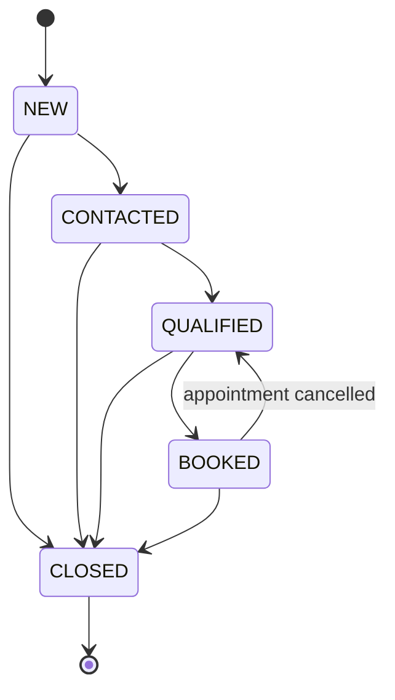

# 05 – API Documentation

**Status:** Contract draft (Phase 2). FastAPI will also generate an OpenAPI 3.1 spec at runtime
(`/api/docs` for Swagger UI, `/api/openapi.json`). This document gives the design intent and the
rules behind it. In Phase 3 it will be checked against the generated spec, and the Postman collection
in `/postman` will be exported from that spec. · **Last updated:** 2026-11-13

## 1. API architecture

- **Style:** REST over HTTPS, JSON bodies, resource-oriented URLs, standard HTTP status codes.
- **Base path:** `/api/v1`. The version is in the path, so a breaking change can be released as `/api/v2`
  while existing clients keep working.
- **Clients:**
  1. The React dashboard (staff), which authenticates with a JWT bearer token.
  2. The WordPress plugin (server-to-server), which authenticates with a service key.
  3. Anonymous callers, who can use read-only public reference data only.
- **Layers** (doc 03 §5): router → service → repository → model. Routers only handle HTTP concerns.
  Business rules such as the status machine, the duplicate check and reference generation live in
  services, so they can be unit tested without HTTP.
- **Conventions:** JSON fields use `snake_case` (they match the Pydantic models, so no alias layer).
  Timestamps are ISO 8601 UTC (`2026-11-13T10:15:00Z`). Money is integer pence with a `_pence`
  suffix. Enums are UPPER_CASE strings.

## 2. Authentication and authorisation

| Mechanism | Used by | Details |
|---|---|---|
| **JWT access token** | Dashboard | `Authorization: Bearer <jwt>`. HS256, 15 min lifetime, claims `sub` (user id), `role`, `exp`, `iat`, `jti`. The token is kept in memory only, not in `localStorage`, to limit XSS impact |
| **Refresh token** | Dashboard | Opaque random value in cookie `sd_refresh` (`HttpOnly; Secure; SameSite=Strict; Path=/api/v1/auth`), 7 days, rotated on every use (doc 04 §4.2) |
| **Service key** | WordPress plugin | `X-Service-Key: <secret>` from the environment. Compared with `hmac.compare_digest` to avoid timing attacks. Only `POST /enquiries` accepts it |
| **None** | Anyone | `GET /clinics`, `GET /treatments`, `GET /treatment-categories` (active, public fields only), `/health` |

**Role enforcement** uses a FastAPI dependency, `require_role(Role.ADMIN)` /
`require_role(Role.STAFF)`. `STAFF` means "staff or admin". Every protected route declares its
role explicitly, and a test walks the router table and fails if any route under `/api/v1` lacks an
auth dependency (except the public allow-list above).

**Why bearer tokens and not session cookies for the access token?** Because a bearer token in an
`Authorization` header cannot be sent by a cross-site form, so the API endpoints do not need CSRF
tokens. The refresh cookie is `SameSite=Strict` and only accepted at `/auth/refresh` and
`/auth/logout`, which also require the `X-Requested-With: fetch` header as a second CSRF guard.

## 3. Common formats

### 3.1 Error envelope
Every error, including FastAPI's own validation errors (re-mapped by a custom exception handler),
uses one shape:

```json
{
  "error": {
    "code": "VALIDATION_ERROR",
    "message": "Some fields are invalid.",
    "details": [
      { "field": "email", "message": "Enter a valid email address." },
      { "field": "preferred_date", "message": "Date cannot be in the past." }
    ]
  },
  "request_id": "6f1c2a9e-1d0b-4d1e-9a3a-1b2c3d4e5f60"
}
```

`request_id` is also returned in the `X-Request-ID` response header and written to the log line, so
a user's error report can be traced. Unhandled exceptions return `500 INTERNAL_ERROR` with a generic
message. Stack traces are logged and never returned.

| HTTP | `code` values |
|---|---|
| 400 | `BAD_REQUEST` |
| 401 | `NOT_AUTHENTICATED`, `INVALID_CREDENTIALS`, `TOKEN_EXPIRED` |
| 403 | `FORBIDDEN` (authenticated, wrong role), `ACCOUNT_DISABLED` |
| 404 | `NOT_FOUND` |
| 409 | `DUPLICATE_ENQUIRY`, `INVALID_TRANSITION`, `CONFLICT` (unique slug/email), `CATEGORY_IN_USE` |
| 422 | `VALIDATION_ERROR` |
| 429 | `RATE_LIMITED` (+ `Retry-After` header) |
| 503 | `SHOP_UNAVAILABLE`, `DATABASE_UNAVAILABLE` |

### 3.2 Pagination
List endpoints take `page` (≥1, default 1) and `page_size` (1–100, default 20) and return:

```json
{ "items": [ … ], "page": 2, "page_size": 20, "total": 134, "pages": 7 }
```

Offset pagination is used because staff jump to arbitrary pages and the dataset is small (thousands
of rows). Keyset pagination would scale better and is noted in doc 11 as a future change.

### 3.3 Sorting
`sort=<field>` ascending, `sort=-<field>` descending. Only fields on an allow-list are accepted; any
other value returns 422. The value is never interpolated into SQL.

## 4. Rate limiting

Implemented with **SlowAPI** (a FastAPI/Starlette wrapper around the `limits` library). It is the one
extra library in the API, and it is added because writing correct sliding-window counting by hand is
error-prone. Storage is in-memory, which is correct for a single API process. With several replicas,
storage would move to Redis (documented, not built).

| Endpoint | Limit | Key |
|---|---|---|
| `POST /enquiries` | 5/minute and 30/day | Original client IP from `X-Client-IP`, trusted **only** when the request carries a valid service key; otherwise the socket IP |
| `POST /auth/login` | 10/minute | Client IP + submitted email (slows down credential stuffing against one account) |
| Everything else (authenticated) | 120/minute | User id |

## 5. Endpoint reference

Legend for **Auth**: `—` public · `SVC` service key · `STAFF` staff or admin · `ADMIN` admin only.

### 5.1 Health
| Method | Path | Auth | Description |
|---|---|---|---|
| GET | `/health` | — | Liveness: `{"status":"ok"}` |
| GET | `/health/ready` | — | Readiness: runs `SELECT 1`. Returns `503 DATABASE_UNAVAILABLE` if PostgreSQL is down. Used by the Docker health check |

### 5.2 Auth
| Method | Path | Auth | Description |
|---|---|---|---|
| POST | `/auth/login` | — | OAuth2 password form (`username`=email, `password`). Returns an access token and sets the refresh cookie |
| POST | `/auth/refresh` | cookie | Rotates the refresh token and returns a new access token |
| POST | `/auth/logout` | cookie | Revokes the refresh token and clears the cookie. `204` |
| GET | `/auth/me` | STAFF | The current user |

`POST /auth/login` → `200`
```json
{
  "access_token": "eyJhbGciOiJIUzI1NiIs…",
  "token_type": "bearer",
  "expires_in": 900,
  "user": { "id": 1, "email": "admin@example.test", "full_name": "Alex Morgan", "role": "ADMIN" }
}
```
Wrong email and wrong password both return the same `401 INVALID_CREDENTIALS`, so attackers cannot
use the response to discover which emails exist. When the email is unknown, the code still runs a
dummy Argon2 verification so the response time is the same.

### 5.3 Enquiries
| Method | Path | Auth | Description |
|---|---|---|---|
| POST | `/enquiries` | SVC | Create an enquiry (public form, via WordPress) |
| GET | `/enquiries` | STAFF | Search / filter / sort / paginate |
| GET | `/enquiries/{id}` | STAFF | Detail with status history and notes |
| PATCH | `/enquiries/{id}/status` | STAFF | Change status (validated transition) |
| POST | `/enquiries/{id}/notes` | STAFF | Add an internal note |
| DELETE | `/enquiries/{id}` | ADMIN | Hard delete (data-erasure request). `204` |
| GET | `/enquiries/export.csv` | STAFF | CSV of the current filter (Could, FR-DASH-13) |

There is no separate "appointment requests" resource. The dashboard's appointment view is
`GET /enquiries?enquiry_type=APPOINTMENT&sort=preferred_date`. One resource with a type filter avoids
duplicating every endpoint.

**`POST /enquiries`**

Headers: `X-Service-Key`, `X-Client-IP`, `Idempotency-Key: <uuid>` (optional but always sent by the plugin).

```json
{
  "enquiry_type": "APPOINTMENT",
  "full_name": "Jamie Fictional",
  "email": "jamie@example.test",
  "phone": "07700 900123",
  "clinic_slug": "riverside",
  "treatment_slug": "dental-implants",
  "preferred_date": "2026-11-24",
  "preferred_time_window": "MORNING",
  "message": "Interested in a consultation.",
  "consent": true
}
```

Validation (Pydantic):

| Field | Rule |
|---|---|
| `enquiry_type` | `GENERAL` or `APPOINTMENT` |
| `full_name` | 2–120 chars after trimming; letters, spaces, `'` `-` `.` |
| `email` | `EmailStr`, lower-cased |
| `phone` | Parsed as a UK number with the `phonenumbers` library (Python port of Google's libphonenumber; hand-written phone regexes are unreliable) and normalised to `+447700900123`; 422 if not valid |
| `clinic_slug` | Must match an **active** clinic |
| `treatment_slug` | Optional; if present, must be an active treatment **offered at that clinic** |
| `preferred_date` | Required when `APPOINTMENT`; today ≤ date ≤ today + 180 days (Europe/London) |
| `preferred_time_window` | Optional enum |
| `message` | ≤ 2000 chars |
| `consent` | Must be `true` |
| unknown fields | Rejected (`extra="forbid"`) |

The API takes **slugs**, not IDs, because slugs are the shared key between WordPress and PostgreSQL
(ADR-04). The plugin never needs to know database IDs.

Responses:
- `201 Created` (new) and `200 OK` (idempotent replay of the same key) share one body:
  ```json
  { "id": "1d6f…", "reference": "SD-7K3M9Q", "status": "NEW", "created_at": "2026-11-13T10:15:00Z" }
  ```
  with a `Location: /api/v1/enquiries/1d6f…` header on 201.
- `409 DUPLICATE_ENQUIRY`, where `details` contains `{"field": "reference", "message": "SD-7K3M9Q"}`
  so the website can show "We already have your request SD-7K3M9Q".
- `422 VALIDATION_ERROR` · `401` missing/invalid service key · `429 RATE_LIMITED`.

The response deliberately contains no personal data. The plugin only needs the reference.

**`GET /enquiries`** query parameters

| Param | Example | Notes |
|---|---|---|
| `q` | `jamie` / `SD-7K3M` | A value starting with `SD-` matches reference by prefix; otherwise trigram `ILIKE` on name and email |
| `status` | `status=NEW&status=CONTACTED` | Repeatable |
| `enquiry_type` | `APPOINTMENT` | |
| `clinic_id`, `treatment_id` | `3` | |
| `created_from`, `created_to` | `2026-10-01` | Inclusive dates, interpreted as Europe/London days |
| `sort` | `-created_at` (default), `created_at`, `preferred_date`, `-preferred_date`, `status`, `full_name` | |
| `page`, `page_size` | | §3.2 |

List item:
```json
{
  "id": "1d6f…", "reference": "SD-7K3M9Q", "enquiry_type": "APPOINTMENT", "status": "NEW",
  "full_name": "Jamie Fictional", "email": "jamie@example.test",
  "clinic": { "id": 3, "name": "Riverside Dental Studio" },
  "treatment": { "id": 7, "name": "Dental implants" },
  "preferred_date": "2026-11-24", "preferred_time_window": "MORNING",
  "created_at": "2026-11-13T10:15:00Z"
}
```

`GET /enquiries/{id}` adds `phone`, `message`, `consent_at`, `close_reason`, `updated_at`,
`history: [{from_status, to_status, close_reason, changed_by: {id, full_name} | null, changed_at}]`,
`notes: [{id, body, author: {id, full_name}, created_at}]` and `allowed_transitions: ["CONTACTED", "CLOSED"]`.
`allowed_transitions` comes from the server, so the dashboard only shows valid buttons and never has
to duplicate the state machine.

**`PATCH /enquiries/{id}/status`**
```json
{ "status": "CLOSED", "close_reason": "NOT_INTERESTED", "note": "Prefers another provider." }
```
`note` is optional. If present, it is saved as a note in the same transaction. Returns the updated
detail (`200`). Errors: `409 INVALID_TRANSITION` (`details` lists the allowed targets),
`422` if `CLOSED` has no `close_reason` or a non-closed status has one.

### 5.4 Reference data: clinics, treatments, categories
| Method | Path | Auth | Description |
|---|---|---|---|
| GET | `/clinics` | — / ADMIN | Active clinics. `?include_inactive=true` requires ADMIN |
| GET | `/clinics/{id}` | — | Includes `treatment_ids` |
| POST | `/clinics` | ADMIN | Create. `409 CONFLICT` on a duplicate slug |
| PATCH | `/clinics/{id}` | ADMIN | Partial update, including `is_active` (deactivate instead of delete) and `treatment_ids` |
| GET | `/treatment-categories` | — | Ordered by `display_order` |
| POST / PATCH | `/treatment-categories[/{id}]` | ADMIN | |
| DELETE | `/treatment-categories/{id}` | ADMIN | `409 CATEGORY_IN_USE` if treatments reference it |
| GET | `/treatments` | — / ADMIN | `?category_id=`, `?clinic_id=`, `?include_inactive=true` (ADMIN) |
| POST / PATCH | `/treatments[/{id}]` | ADMIN | |

Public `GET` responses send `Cache-Control: public, max-age=300`. The plugin also caches them in a
transient (ADR-04).

### 5.5 Analytics (FR-DASH-10)
All endpoints take `from`, `to` (dates, default the last 90 days) and an optional `clinic_id`. Auth:
STAFF. Definitions are in doc 04 §6.3.

| Method | Path | Returns |
|---|---|---|
| GET | `/analytics/summary` | `{total, by_status: {NEW: n, …}, booked, conversion_rate, median_hours_to_contact}` |
| GET | `/analytics/by-treatment` | `[{treatment_id, treatment_name, total, booked, conversion_rate}]` sorted by total desc |
| GET | `/analytics/by-clinic` | Same shape keyed by clinic |
| GET | `/analytics/timeseries` | `?interval=day\|week\|month` → `[{period_start, total, booked}]` with empty periods filled with zeros (`generate_series`) |

`conversion_rate` is a number between 0 and 1, or `null` when `total` is 0. The UI formats it as a
percentage. Each endpoint is a single aggregate SQL query; nothing is loaded into Python and counted.

### 5.6 Users (FR-DASH-12, ADMIN)
| Method | Path | Description |
|---|---|---|
| GET | `/users` | Paginated list |
| POST | `/users` | `{email, full_name, role, password}`. Password ≥ 12 chars, checked against a small common-password list |
| PATCH | `/users/{id}` | `role`, `is_active`, `full_name`, `password`. An admin cannot deactivate or demote themselves (`409`), so there is always at least one active admin |

### 5.7 Shop (FR-DASH-11, STAFF)
| Method | Path | Description |
|---|---|---|
| GET | `/shop/summary` | `{orders_last_30_days, revenue_last_30_days_pence, currency: "GBP", recent_orders: [{number, status, total_pence, created_at, item_count}]}` |

FastAPI calls `GET /wp-json/wc/v3/orders` with **read-only** WooCommerce consumer keys over the
internal Docker network (ADR-06) and caches the result for 60 seconds. Customer names and addresses
from orders are **not** passed on to the dashboard. If WooCommerce is unreachable or times out
(3 s), the endpoint returns `503 SHOP_UNAVAILABLE` and the dashboard panel shows a non-blocking
message. The rest of the dashboard keeps working.

## 6. Enquiry status machine



| From | Allowed to |
|---|---|
| `NEW` | `CONTACTED`, `CLOSED` |
| `CONTACTED` | `QUALIFIED`, `CLOSED` |
| `QUALIFIED` | `BOOKED`, `CLOSED` |
| `BOOKED` | `CLOSED`, `QUALIFIED` (appointment cancelled, needs rebooking) |
| `CLOSED` | none (terminal; a returning patient creates a new enquiry) |

Skipping steps (e.g. `NEW → BOOKED`) is not allowed. This keeps the funnel analytics honest. If a
patient books on the first call, staff record `CONTACTED → QUALIFIED → BOOKED` in a few seconds,
because each step has a timestamp. This is a deliberate trade-off and is open to review.

## 7. Integration contracts with WordPress

| Direction | Call | Auth | Failure handling |
|---|---|---|---|
| WP → API | `POST /api/v1/enquiries` | Service key | Timeout 5 s. On a network error or 5xx, the form is re-shown with the visitor's input kept and a "please call the clinic" message with the phone number. The data is **not** queued in WordPress, so personal data is never stored in two places |
| WP → API | `GET /clinics`, `GET /treatments` | — | Cached for 10 min in a transient. If the API is down, the last good copy is served (stale-while-error) |
| API → WP | `GET /wp-json/wc/v3/orders` | WC read-only keys (Basic auth over the internal network) | §5.7 |
| CLI | `wp synergy sync-check` | — | Lists slugs that exist on only one side (ADR-04) |

## 8. Testing the contract

- **Pytest + HTTPX `AsyncClient`** against a real PostgreSQL test database. One test module per router,
  covering the happy path, every documented error code and the role matrix (401 / 403 / 200 for each role).
- **Schemathesis** (Could): property-based fuzzing from the generated OpenAPI spec. It is listed here
  but will only be added if time allows, and it will be justified in doc 07 if used.
- **Postman** collection with environment variables (`baseUrl`, `accessToken`) and test scripts that
  capture the token from the login response. It can be run headless with Newman in CI.

## 9. Change log

| Date | Change | Reason |
|---|---|---|
| 2026-11-13 | First contract draft | Phase 2 |
